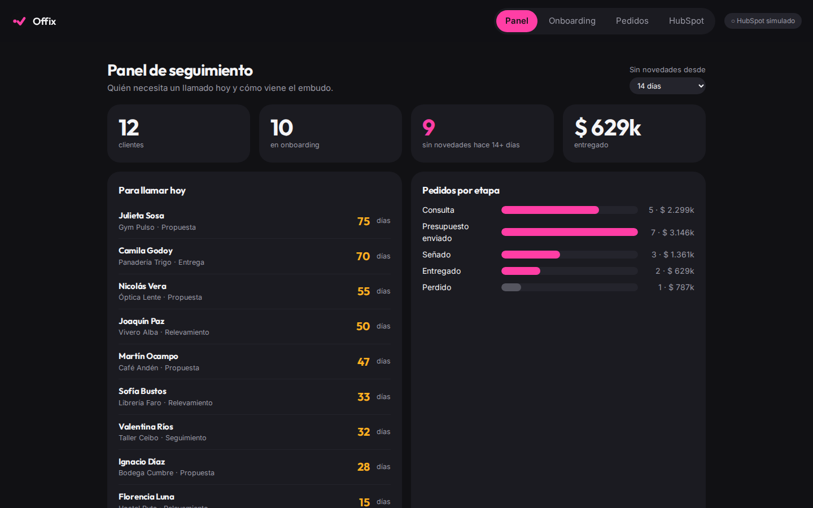
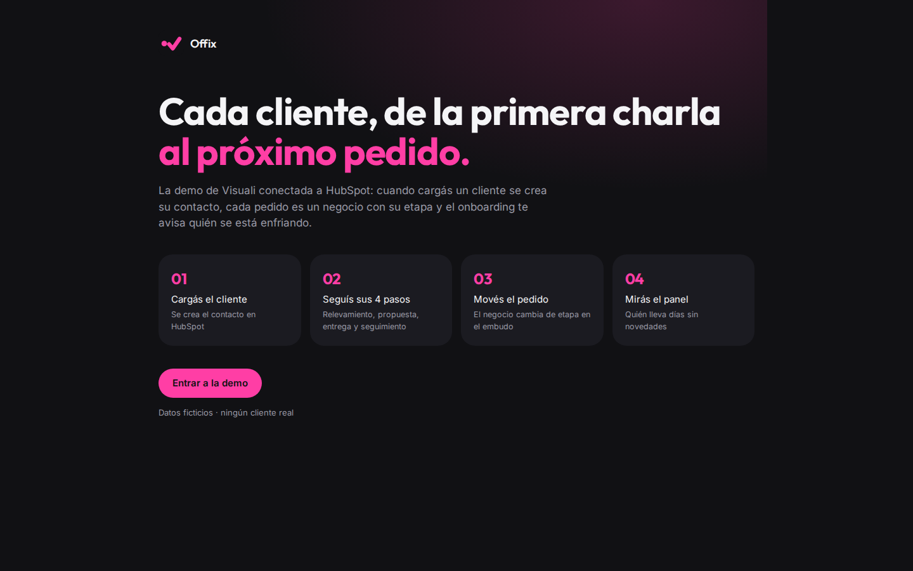
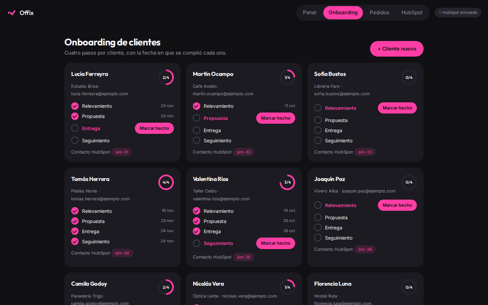
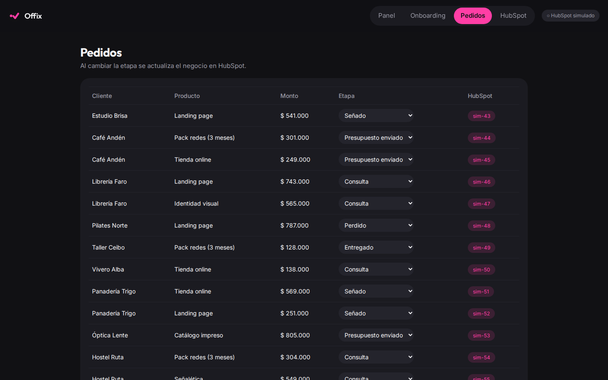
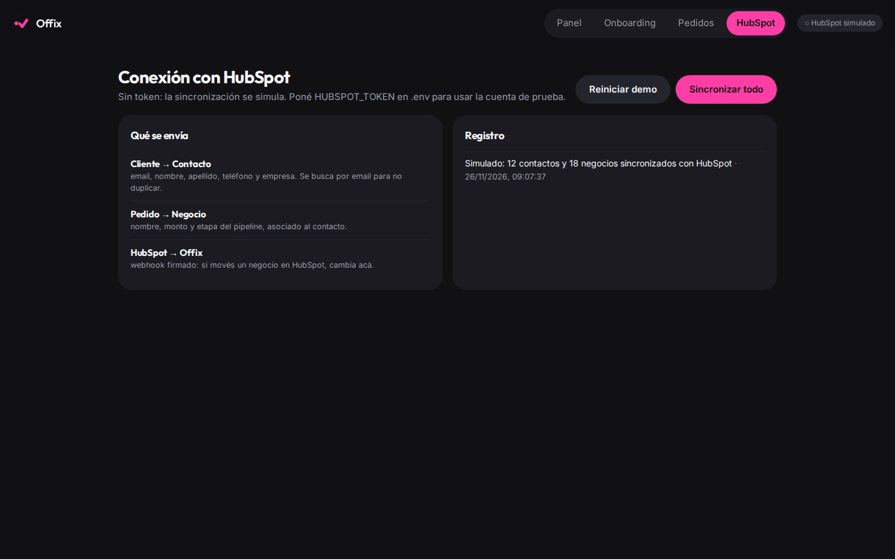
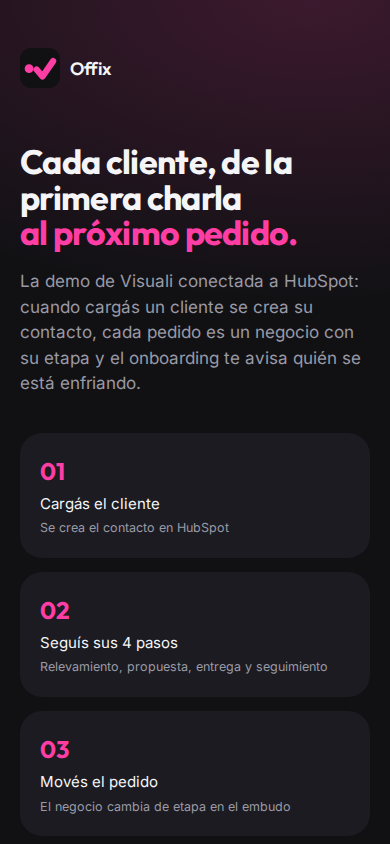
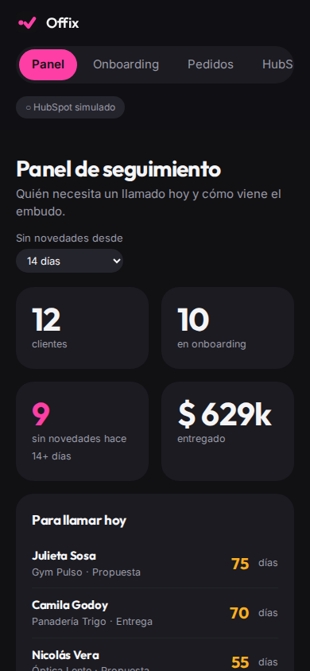
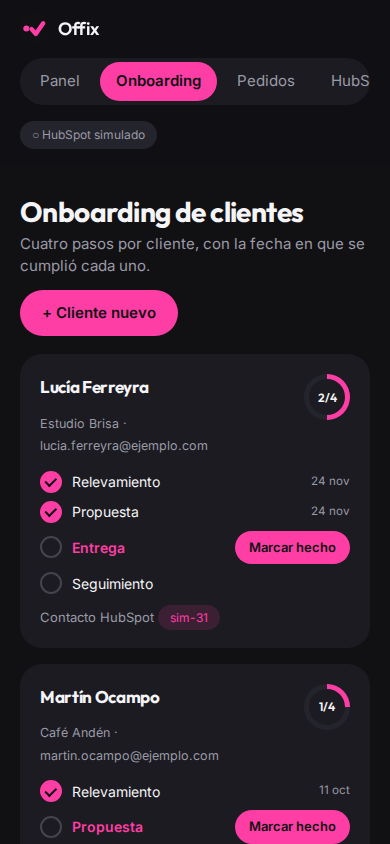
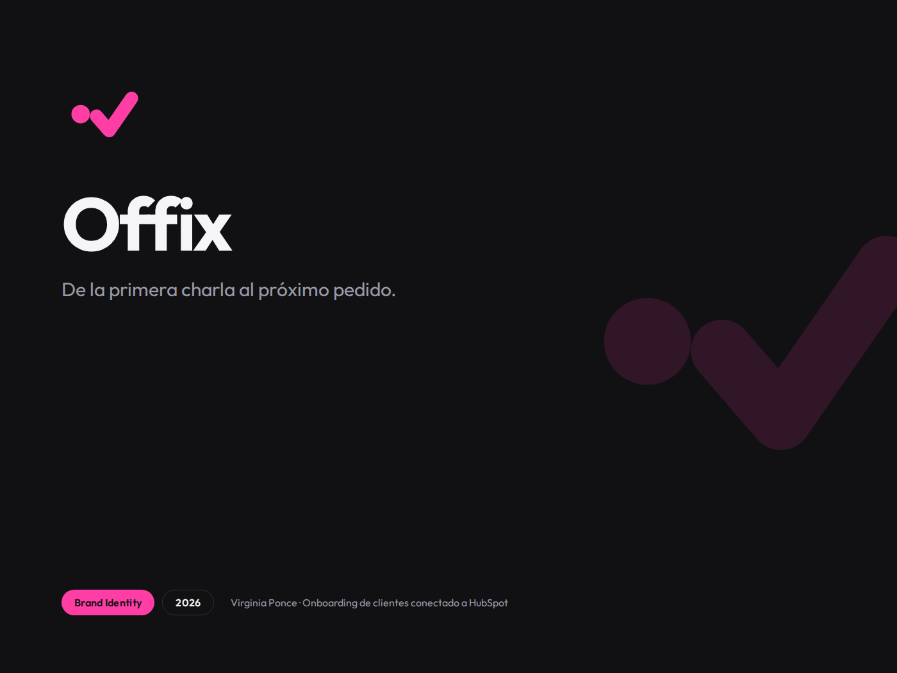

<p align="center"></p>

# Offix

**Onboarding de clientes conectado a HubSpot.** Una demo de Visuali, mi sistema de gestión, donde cada cliente nuevo crea un contacto en HubSpot, cada pedido es un negocio con su etapa, y un onboarding de cuatro pasos muestra a quién hay que llamar hoy.

Todos los datos de la demo son ficticios (emails `@ejemplo.com`): no hay clientes ni proveedores reales.



## Qué resuelve

En un negocio chico el seguimiento de clientes vive en la cabeza de alguien o en un chat: los presupuestos se enfrían y nadie se entera. Las herramientas de CRM ayudan, pero si hay que cargar todo dos veces, se dejan de usar.

Offix ordena el trabajo diario en **4 pasos por cliente** (relevamiento, propuesta, entrega y seguimiento) y manda a HubSpot lo que le sirve al área comercial, sin carga manual:

| Acá | En HubSpot |
|---|---|
| Cliente nuevo | Contacto (buscado por email antes de crear: no se duplica) |
| Pedido y su etapa | Negocio asociado al contacto, con la etapa del pipeline |
| — | Si alguien mueve el negocio en HubSpot, vuelve por webhook |

## Pantallas

| Bienvenida | Onboarding |
|---|---|
|  |  |
| **Pedidos** | **Conexión con HubSpot** |
|  |  |

En el celular:

<p>
  
  
  
</p>

## Cómo probarlo

Requiere Node.js 22.18 o superior (ejecuta el TypeScript del servidor directamente). `npm start` compila antes
la interfaz (`web/app.ts` → `public/app.js`). Para verificar los tipos: `npm run typecheck`; pruebas: `npm test`.

```bash
npm start
```

Abrí http://localhost:5180 y tocá **Entrar a la demo**. Sin token de HubSpot, la sincronización se simula y el registro muestra qué se habría enviado.

```bash
npm test
```

13 pruebas con el test runner de Node: armado de contactos y negocios, búsqueda por email antes de crear, asociación negocio → contacto, firma de webhooks, días sin novedades y embudo.

## Conectar una cuenta de HubSpot (gratis)

1. Creá una cuenta gratuita de HubSpot (o una cuenta de prueba para desarrolladores).
2. **Configuración → Integraciones → Apps privadas → Crear app privada**, con los permisos `crm.objects.contacts.read/write` y `crm.objects.deals.read/write`.
3. Copiá `.env.example` como `.env` y pegá el token en `HUBSPOT_TOKEN`.
4. Reiniciá con `npm start` y tocá **HubSpot → Sincronizar todo**. Los 12 clientes aparecen como contactos y sus pedidos en el embudo de negocios.

**Webhook (opcional):** en la app, suscribite a `deal.propertyChange` de la propiedad `dealstage` con la URL `https://<tu-demo>/webhooks/hubspot` y poné el secreto del cliente en `HUBSPOT_CLIENT_SECRET`. Las llamadas sin firma válida (o con más de 5 minutos) se rechazan.

## Cómo está hecho

| Capa | Qué uso |
|---|---|
| Frontend | HTML, CSS y TypeScript (strict) sin framework ni bundler, compilado con `tsc` · PWA |
| Backend | Node.js + TypeScript (strict) con servidor HTTP propio, sin dependencias en producción |
| Integración | API REST v3 de HubSpot (contactos, negocios, asociaciones) · webhooks con firma v3 |
| Datos | JSON en `data/estado.json` (se genera solo con datos ficticios) |
| Pruebas | `node --test` con un HubSpot falso inyectado |
| Diseño | Figma (pantallas y análisis UX/UI) · FigJam (flujo) · manual de marca de 15 láminas |

```
server.ts            servidor HTTP: API, webhook y archivos estáticos
src/demo.ts          datos ficticios con semilla, pasos y etapas
src/hubspot.ts       sincronización con HubSpot y verificación de firmas
src/seguimiento.ts   pasos, días sin novedades y embudo
src/tipos.ts         tipos del dominio (cliente, pedido, estado)
web/app.ts           interfaz (se compila a public/app.js)
public/              HTML, estilos y recursos de la app (PWA)
pruebas/             pruebas de sincronización y seguimiento
docs/                flujo, guía para el cliente, marca y Figma
```

### API

| Método | Ruta | Qué hace |
|---|---|---|
| `GET` | `/api/estado?dias=14` | Clientes, pedidos, embudo y clientes sin novedades |
| `POST` | `/api/clientes` | Alta de cliente → contacto en HubSpot |
| `POST` | `/api/clientes/:id/pasos/:paso` | Marca un paso del onboarding |
| `PATCH` | `/api/pedidos/:id` | Cambia la etapa → actualiza el negocio |
| `POST` | `/api/sincronizar` | Envía todos los clientes y pedidos |
| `POST` | `/webhooks/hubspot` | Recibe cambios de etapa desde HubSpot |

### Decisiones

- **El email es la llave.** Antes de crear un contacto se intenta actualizar por email (`idProperty=email`); recién si no existe se crea. Una carga repetida no duplica.
- **El onboarding vive acá, no en HubSpot.** Los 4 pasos son del trabajo diario; HubSpot recibe lo comercial (contactos, negocios y etapas).
- **`fetch` inyectable.** Las pruebas reemplazan HubSpot por un falso que guarda cada llamada, así se prueba sin red y sin cuenta.
- **Funciona sin cuenta.** Sin token, la sincronización se simula: la demo se puede mostrar en cualquier lado.

## Documentación

- [Flujo de onboarding](docs/flujo.md) — diagrama, qué se envía en cada paso y equivalencia de etapas
- [Guía de uso para el cliente](docs/guia-cliente.md)
- [Figma y FigJam](docs/figma/LEEME.md) — scripts que dibujan las pantallas, el análisis UX/UI y el flujo
- [Manual de marca](docs/branding/) — 15 láminas

## Marca

Grafito `#111114` y un solo acento fucsia `#FF3EA5`, con Outfit e Inter. El logo es un punto y un check: el cliente entra y llega a destino. Está pensado para leerse en 16 px (el trazo nunca baja de 2 px).



---

Hecho por Virginia Ponce.
