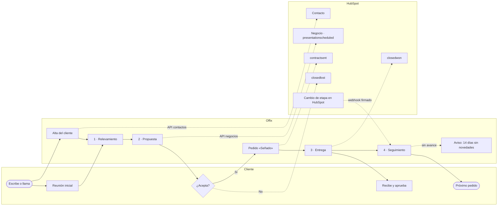

# Flujo de onboarding

Cómo pasa un cliente de la primera consulta al próximo pedido, y qué se sincroniza con HubSpot en cada paso.
La versión visual está en FigJam (`figma/flujo-figjam.js`, se pega en Scripter dentro de un tablero).

## Qué pasa con los datos en cada paso

| Momento | En Offix | En HubSpot |
|---|---|---|
| Alta del cliente | Ficha con los 4 pasos sin hacer | Contacto (se busca por email antes de crear: no se duplica) |
| Pedido nuevo o cambio de etapa | Etapa del pedido | Negocio asociado al contacto, con la etapa equivalente del pipeline |
| Paso marcado como hecho | Fecha del paso y «última novedad» | — |
| 14 días sin novedades | Aparece en «Para llamar hoy» | — |
| Alguien mueve el negocio en HubSpot | El pedido cambia de etapa (webhook con firma v3) | — |

## Equivalencia de etapas

| Offix | Pipeline de HubSpot |
|---|---|
| Consulta | `appointmentscheduled` |
| Presupuesto enviado | `presentationscheduled` |
| Señado | `contractsent` |
| Entregado | `closedwon` |
| Perdido | `closedlost` |

## Decisiones
- **El email es la llave.** Antes de crear un contacto se busca por email (`idProperty=email`), así una carga repetida no duplica.
- **El onboarding vive en Offix, no en HubSpot.** Los 4 pasos son del trabajo diario; HubSpot recibe lo que le sirve al área comercial: contactos, negocios y etapas.
- **Sin token, todo se simula.** La demo funciona sin cuenta y el registro muestra qué se habría enviado.
- **Los webhooks se verifican.** Si la firma no coincide o tiene más de 5 minutos, se rechaza.
